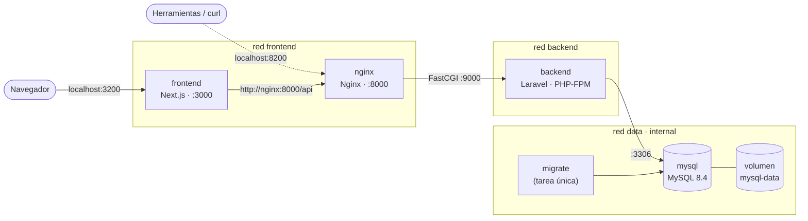

# docker-stack · NovaShop en contenedores

Ecosistema de producción formado por una tienda en línea con **Next.js 16**, su API REST en **Laravel 12** y una base de datos **MySQL 8.4**. Cada pieza corre en su propio contenedor, construido con imágenes **multi-stage** optimizadas y orquestado con **Docker Compose**.

## 1. Descripción

NovaShop es una tienda de demostración. Permite:

- ver el catálogo con búsqueda, orden y paginación;
- crear una cuenta, iniciar sesión, usar el carrito y registrar órdenes de compra;
- administrar productos desde un panel con **CRUD completo** (crear, editar y eliminar), que guarda los cambios en MySQL a través de Laravel;
- consultar la página **Estado del sistema**, que comprueba en vivo si el frontend llega a la API y si la API llega a MySQL.

El pago con tarjeta usa Stripe en modo de pruebas y solo funciona si se configuran las claves de Stripe (ver [Configuración](#8-configuración)). Sin ellas, el resto de la tienda funciona igual.

### Aplicaciones reutilizadas del bootcamp

El ecosistema no parte de cero. Se reutilizan dos proyectos previos, copiados de forma controlada (solo los archivos versionados) en este repositorio. Los repositorios originales no se modificaron.

| Carpeta | Proyecto original | Commit de origen |
| --- | --- | --- |
| `backend/` | [ecommerce-api-laravel12](https://github.com/YamiLinares/ecommerce-api-laravel12) | `1c48b` |
| `frontend/` | [nextjs-ecommerce-web-vitals](https://github.com/YamiLinares/nextjs-ecommerce-web-vitals) | `86da0` |

Del frontend no se copiaron las capturas de evidencias ni los scripts de Lighthouse, que no forman parte de la aplicación. Los cambios hechos para esta actividad están en commits separados del historial:

- **API (Laravel):**
  - endpoint `GET /api/health`, que consulta MySQL;
  - comando `db:seed-once`;
  - pruebas nuevas.
- **Frontend (Next.js):**
  - panel de administración de productos (`/admin/productos`);
  - página `/estado`;
  - endpoint `/api/health` para el healthcheck;
  - salida `standalone`.

## 2. Objetivo académico

Aplicar ingeniería de imágenes eficientes con Docker en un sistema real de tres capas:

- builds **multi-stage** que separan la compilación de la ejecución;
- **caché de capas**, copiando primero los manifiestos (`package-lock.json`, `composer.lock`);
- **instalación reproducible** con `npm ci` y `composer install` a partir del lockfile;
- imágenes finales **sin herramientas de compilación, sin dependencias de desarrollo y sin secretos**;
- procesos que se ejecutan **sin root**;
- **Docker Compose** con redes separadas, healthchecks, dependencias condicionadas y un volumen persistente para MySQL.

## 3. Tecnologías

| Pieza | Tecnología | Imagen base |
| --- | --- | --- |
| Frontend | Next.js 16.4, React 19.3, TypeScript, Tailwind CSS 4 | `node:24-alpine` |
| Servidor web de la API | Nginx 1.28 | `nginx:1.28-alpine` |
| Backend | Laravel 12, PHP 8.4 con PHP-FPM, JWT | `php:8.4-fpm-alpine` |
| Base de datos | MySQL 8.4 LTS | `mysql:8.4` |
| Orquestación | Docker Engine 29, Docker Compose 2.40 | — |

### Versiones elegidas frente a las sugeridas

| Sugerida | Usada | Motivo |
| --- | --- | --- |
| `node:20-alpine` | `node:24-alpine` | Next.js 16 exige Node ≥ 20.9 y Node 20 dejó de recibir soporte en abril de 2026. Node 24 es la LTS vigente. |
| `php:8.2-fpm-alpine` | `php:8.4-fpm-alpine` | El `composer.lock` de la API incluye paquetes de Symfony 8 que exigen PHP ≥ 8.4.1. Con PHP 8.2, `composer install` falla. |
| `mysql:8.0` | `mysql:8.4` | MySQL 8.0 dejó de recibir soporte en abril de 2026. La 8.4 es la versión LTS y cumple "8.0 o superior". |

## 4. Arquitectura



Cómo viaja una petición:

1. **Navegador → frontend.** El navegador solo habla con Next.js, publicado en `127.0.0.1:3200`.
2. **frontend → nginx.** El servidor de Next.js llama a la API por la red interna con la URL `http://nginx:8000/api`. No usa `localhost`, que dentro del contenedor del frontend sería el propio frontend. El token JWT se guarda en una cookie `httpOnly`, así que el JavaScript del navegador nunca lo ve.
3. **nginx → backend.** Nginx sirve los archivos de `public/` y pasa el resto a PHP-FPM por FastCGI (`backend:9000`). PHP-FPM no está publicado.
4. **backend → mysql.** Laravel se conecta a `mysql:3306` por la red `data`, que es `internal`: no tiene salida a Internet y no es accesible desde el equipo.

| Servicio | Redes | Puerto interno | Puerto en el equipo |
| --- | --- | --- | --- |
| `frontend` | frontend | 3000 | `127.0.0.1:3200` |
| `nginx` | frontend, backend | 8000 | `127.0.0.1:8200` (API y Swagger, para verificación) |
| `backend` | backend, data | 9000 (FastCGI) | ninguno |
| `mysql` | data | 3306 | ninguno |
| `migrate` | data | — | ninguno (se ejecuta y termina) |

Nginx escucha en el puerto 8000 y no en el 80 porque se ejecuta sin root: un usuario sin privilegios no puede abrir puertos menores que 1024.

Las direcciones de cada contexto son distintas:

| Desde | Para llegar a la API usa |
| --- | --- |
| El contenedor `frontend` | `http://nginx:8000/api` (nombre del servicio) |
| Windows (navegador, curl) | `http://localhost:8200/api` |
| El navegador, desde la tienda | Nunca llama a la API: todo pasa por Next.js |

## 5. Estructura

```text
docker-stack/
├── docker-compose.yml             # Orquestación de los 5 servicios
├── docker-compose.mysql-port.yml  # Opcional: publica MySQL en 127.0.0.1 (solo desarrollo)
├── .env.example                   # Plantilla de variables (sin secretos)
├── docker/mysql/init/
│   └── 01-test-database.sh        # Crea la base de pruebas al crear el volumen
├── scripts/
│   └── smoke-test.sh              # Prueba de integración del ecosistema
├── frontend/                      # Next.js 16 (App Router, TypeScript)
│   ├── Dockerfile
│   ├── .dockerignore
│   ├── next.config.ts             # output: "standalone"
│   ├── src/
│   │   ├── app/                   # Rutas: catálogo, carrito, checkout, admin/productos, estado…
│   │   ├── actions/               # Server Actions (auth, órdenes, CRUD de productos)
│   │   ├── components/
│   │   └── lib/                   # Cliente de la API, sesión, validación con Zod
│   └── tests/                     # Pruebas unitarias (Vitest)
└── backend/                       # Laravel 12 (API REST)
    ├── Dockerfile
    ├── .dockerignore
    ├── docker/
    │   ├── nginx/                 # nginx.conf (sin root) y default.conf (vhost)
    │   └── php/                   # app.ini (OPcache), fpm-pool.conf, entrypoint.sh
    ├── app/                       # Controladores, modelos, políticas, recursos, OpenAPI
    ├── database/                  # Migraciones, factories y seeders
    ├── routes/                    # api.php, console.php (db:seed-once), web.php
    └── tests/                     # PHPUnit (Feature y Unit)
```

Los archivos `frontend/.env.example` y `backend/.env.example` vienen de los proyectos originales y solo sirven para ejecutar cada aplicación fuera de Docker. Para el ecosistema se usa el `.env.example` de la raíz.

## 6. Requisitos

- **Docker** con el plugin **Docker Compose v2**: Docker Desktop en Windows o macOS, o Docker Engine en Linux. Debe estar iniciado.
- **Git**, para clonar el repositorio.
- Puertos **3200** y **8200** libres en el equipo, o cambiarlos en `.env`.

No hace falta instalar Node.js, PHP, Composer ni MySQL: todo se instala y se compila dentro de las imágenes.

## 7. Instalación

```bash
git clone https://github.com/YamiLinares/docker-stack.git
cd docker-stack
```

## 8. Configuración

### 8.1 Crear `.env`

```powershell
Copy-Item .env.example .env      # PowerShell
```

```bash
cp .env.example .env             # Linux / macOS
```

### 8.2 Completar los valores

Reemplaza todos los valores que empiezan por `cambia-esto` por contraseñas propias, y genera las dos claves de la aplicación:

**`APP_KEY`** (clave de cifrado de Laravel):

```powershell
# PowerShell
$b = New-Object byte[] 32; [Security.Cryptography.RandomNumberGenerator]::Create().GetBytes($b); "base64:" + [Convert]::ToBase64String($b)
```

```bash
# Linux / macOS
echo "base64:$(openssl rand -base64 32)"
```

**`JWT_SECRET`** (firma de los tokens de sesión):

```powershell
# PowerShell
$b = New-Object byte[] 48; [Security.Cryptography.RandomNumberGenerator]::Create().GetBytes($b); [Convert]::ToBase64String($b)
```

```bash
# Linux / macOS
openssl rand -base64 48
```

Copia cada resultado después del `=` correspondiente en `.env`. Si falta alguna variable obligatoria, Docker Compose se detiene con un mensaje como `Falta APP_KEY en .env`.

### 8.3 Variables

| Variable | Uso |
| --- | --- |
| `FRONTEND_PORT`, `BACKEND_PORT` | Puertos publicados en `127.0.0.1` (3200 y 8200 por defecto). |
| `MYSQL_ROOT_PASSWORD`, `MYSQL_DATABASE`, `MYSQL_USER`, `MYSQL_PASSWORD` | Configuración de MySQL. Solo se aplican al crear el volumen por primera vez. |
| `APP_ENV`, `APP_DEBUG`, `APP_KEY`, `APP_URL`, `LOG_LEVEL` | Configuración de Laravel. En producción `APP_DEBUG=false`. |
| `DB_CONNECTION`, `DB_HOST`, `DB_PORT` | Conexión de Laravel: `mysql`, `mysql` (nombre del servicio) y `3306`. |
| `DB_DATABASE`, `DB_USERNAME`, `DB_PASSWORD` | Se toman de las variables `MYSQL_*` para no escribir las credenciales dos veces. |
| `JWT_SECRET` | Firma de los tokens JWT. |
| `STRIPE_KEY`, `STRIPE_SECRET`, `STRIPE_WEBHOOK_SECRET`, `STORE_CURRENCY` | Opcionales: claves de Stripe en modo de pruebas y moneda de la tienda. |
| `SEED_ADMIN_EMAIL`, `SEED_ADMIN_PASSWORD`, `SEED_CUSTOMER_EMAIL`, `SEED_CUSTOMER_PASSWORD` | Usuarios de demostración que se crean en el primer arranque. Si una contraseña queda vacía, se genera una aleatoria y se muestra una sola vez en `docker compose logs migrate`. |
| `MYSQL_HOST_PORT` | Solo con `docker-compose.mysql-port.yml`. |

> **Importante.** MySQL aplica `MYSQL_*` únicamente cuando el volumen está vacío. Si después cambias `MYSQL_PASSWORD` en `.env`, Laravel usará la nueva contraseña pero MySQL seguirá esperando la anterior. Para cambiarla de verdad hay que hacerlo dentro de MySQL (`ALTER USER`). Lo mismo ocurre con `APP_KEY`: cambiarla invalida los datos cifrados existentes. Este proyecto no guarda datos cifrados con esa clave, así que en la práctica solo se cerrarían las sesiones abiertas.

## 9. Construcción

```bash
docker compose build
```

Construye tres imágenes propias: `docker-stack/frontend`, `docker-stack/backend` y `docker-stack/nginx`. Las dos últimas salen del mismo `backend/Dockerfile`, con los targets `runtime` y `web`. La primera construcción tarda unos minutos; las siguientes reutilizan la caché de capas y la caché de npm y Composer de BuildKit.

## 10. Ejecución

```bash
docker compose up --build
```

O en segundo plano, esperando a que todos los servicios estén sanos:

```bash
docker compose up --build -d --wait
```

Orden de arranque, controlado con `depends_on` y `condition`:

1. `mysql` arranca y pasa su healthcheck (`mysqladmin ping` por TCP).
2. `migrate` aplica las migraciones y siembra los datos de demostración. Termina con código 0.
3. `backend` (PHP-FPM) arranca solo si `mysql` está sano **y** `migrate` terminó correctamente.
4. `nginx` espera a que `backend` esté sano.
5. `frontend` espera a que `nginx` esté sano.

| Qué | URL |
| --- | --- |
| Tienda (frontend) | http://localhost:3200 |
| Estado del sistema | http://localhost:3200/estado |
| Panel de productos | http://localhost:3200/admin/productos |
| API | http://localhost:8200/api |
| Documentación interactiva (Swagger) | http://localhost:8200/api/documentation |

Para entrar al panel se usa el administrador definido en `SEED_ADMIN_EMAIL` y `SEED_ADMIN_PASSWORD`.

Para detener el ecosistema conservando los datos:

```bash
docker compose down      # elimina contenedores y redes; el volumen de MySQL se conserva
```

`docker compose down -v` borraría también el volumen y, con él, todos los datos de MySQL.

## 11. Migraciones

Las migraciones se ejecutan **solas** en cada `docker compose up`, en el servicio `migrate`:

```text
php artisan migrate --force && php artisan db:seed-once
```

- `migrate --force` solo aplica las migraciones pendientes. Si no hay ninguna, muestra `Nothing to migrate`.
- `db:seed-once` es un comando propio (`backend/routes/console.php`): siembra usuarios y productos **solo si la base está vacía**, para que reiniciar el ecosistema no deshaga los cambios hechos desde el panel.

Para ejecutarlas a mano:

```bash
docker compose run --rm migrate                                   # migrar + sembrar si está vacía
docker compose run --rm migrate php artisan migrate:status         # estado de las migraciones
```

### Script de inicialización de MySQL

`docker/mysql/init/01-test-database.sh` se monta en `/docker-entrypoint-initdb.d/`. MySQL ejecuta estos scripts **solo cuando crea el volumen por primera vez**; en los arranques siguientes los ignora. Este script crea la base `ecommerce_api_laravel12_test`, que usa PHPUnit, y da permisos sobre ella al usuario de la aplicación. No contiene credenciales: las toma de las variables del contenedor.

## 12. Verificación

```bash
docker compose ps                          # estado y salud de cada servicio
docker compose logs -f frontend            # registros (también: nginx, backend, mysql, migrate)
docker compose logs migrate                # resultado de las migraciones
curl http://localhost:8200/api/health      # API + conexión real a MySQL
curl http://localhost:3200/api/health      # servidor Next.js
bash scripts/smoke-test.sh                 # prueba de integración completa (Linux, macOS, WSL o Git Bash)
```

Salud de los contenedores:

```bash
docker inspect --format '{{.State.Health.Status}}' docker-stack-mysql-1
```

Consultar MySQL desde dentro de su contenedor, sin publicar el puerto:

```bash
docker compose exec mysql sh -c 'MYSQL_PWD="$MYSQL_PASSWORD" mysql -u"$MYSQL_USER" "$MYSQL_DATABASE" -e "select sku, name, price, stock from products limit 5"'
```

Si necesitas conectarte con una herramienta gráfica, existe un archivo opcional que publica MySQL **solo en 127.0.0.1**:

```bash
docker compose -f docker-compose.yml -f docker-compose.mysql-port.yml up -d
```

## 13. Endpoints

Todas las rutas usan el prefijo `/api` y responden en JSON. Los errores tienen siempre la misma forma: `{"message", "code", "errors"?}`. La especificación completa está en Swagger: http://localhost:8200/api/documentation.

### Estado

| Método | Ruta | Acceso | Descripción |
| --- | --- | --- | --- |
| GET | `/api/health` | Público | Estado de la API y consulta real a MySQL. Responde 503 si MySQL no responde. |

```json
{"status":"ok","service":"laravel-api","database":{"status":"ok","driver":"mysql","latency_ms":1.7,"products":22},"checked_at":"2026-11-07T16:35:08+00:00"}
```

### Productos (CRUD)

| Método | Ruta | Acceso | Descripción |
| --- | --- | --- | --- |
| GET | `/api/products` | Público | Lista paginada. Parámetros: `search`, `sort`, `in_stock`, `min_price`, `max_price`, `per_page`, `page` e `include_inactive` (este último solo para administradores). |
| GET | `/api/products/{id}` | Público | Detalle. Los inactivos solo los ve un administrador. |
| POST | `/api/products` | Administrador | Crea un producto. Responde 201. |
| PUT/PATCH | `/api/products/{id}` | Administrador | Actualiza un producto. |
| DELETE | `/api/products/{id}` | Administrador | Borrado lógico (soft delete). Responde 204. |

```json
{"data":{"id":1,"sku":"TEC-001","name":"Teclado mecánico TKL","description":"Teclado mecánico sin teclado numérico, switches rojos y retroiluminación RGB.","price":"79.90","stock":40,"is_active":true,"created_at":"2026-11-07T16:19:39+00:00","updated_at":"2026-11-07T16:19:39+00:00"}}
```

Validación (`StoreProductRequest`): `sku` obligatorio, único, en mayúsculas, números y guiones; `name` de 2 a 150 caracteres; `price` decimal con hasta 2 decimales, mínimo 0.50; `stock` entero entre 0 y 1 000 000; `is_active` booleano.

### Autenticación (JWT)

| Método | Ruta | Acceso | Descripción |
| --- | --- | --- | --- |
| POST | `/api/auth/register` | Público | Crea una cuenta de cliente y devuelve un token. |
| POST | `/api/auth/login` | Público | Inicia sesión y devuelve `access_token`, `expires_in` y el usuario. |
| GET | `/api/auth/me` | Autenticado | Usuario actual (incluye su rol). |
| POST | `/api/auth/logout` | Autenticado | Invalida el token (lista negra). |
| POST | `/api/auth/refresh` | Autenticado | Renueva el token. |

Ejemplo de error sin token:

```json
{"message":"No autenticado. Envíe un token JWT válido en la cabecera Authorization: Bearer <token>.","code":"UNAUTHENTICATED"}
```

### Órdenes, pagos y administración

| Método | Ruta | Acceso | Descripción |
| --- | --- | --- | --- |
| GET | `/api/orders` | Autenticado | Órdenes del usuario. |
| POST | `/api/orders` | Autenticado | Crea una orden y reserva stock. |
| GET | `/api/orders/{id}` | Autenticado | Detalle de una orden propia. |
| POST | `/api/orders/{id}/cancel` | Autenticado | Cancela una orden pendiente y libera el stock. |
| GET | `/api/orders/{id}/payments` | Autenticado | Pagos de una orden. |
| POST | `/api/orders/{id}/payments` | Autenticado | Inicia el pago con Stripe. Requiere claves de Stripe. |
| GET | `/api/admin/orders` | Administrador | Todas las órdenes. |
| PATCH | `/api/admin/orders/{id}/status` | Administrador | Cambia el estado de una orden. |
| POST | `/api/webhooks/stripe` | Firma de Stripe | Eventos de pago verificados por firma. |

## 14. Dockerfiles

### Frontend: `frontend/Dockerfile`

| Etapa | Base | Qué hace |
| --- | --- | --- |
| `deps` | `node:24-alpine` | Copia solo `package.json` y `package-lock.json` y ejecuta `npm ci` con caché de BuildKit. |
| `build` | `node:24-alpine` | Recibe `node_modules`, copia el código y ejecuta `next build`. `NEXT_PUBLIC_SITE_URL` entra como argumento de build porque es un dato público. |
| `runtime` | `node:24-alpine` | Copia solo `.next/standalone`, `.next/static` y `public`. Corre como `node`, con `NODE_ENV=production` y `HOSTNAME=0.0.0.0`. Se inicia con `node server.js`, sin npm ni `npm run dev`. |

Con `output: "standalone"` Next.js genera un `server.js` y copia solo los módulos que usa en ejecución: 38 MB, frente al `node_modules` completo de la etapa de build.

La portada se renderiza en cada petición y no al compilar. Durante `docker build` no hay API disponible, y si se prerenderizara quedaría guardada con el mensaje de error. Los datos del catálogo siguen saliendo de la caché de datos de Next.js (5 minutos), así que Laravel no recibe más tráfico.

### Backend: `backend/Dockerfile`

| Etapa | Base | Qué hace |
| --- | --- | --- |
| `base` | `php:8.4-fpm-alpine` | Compila `pdo_mysql` y `bcmath`. El compilador (`$PHPIZE_DEPS`) se instala y se elimina **en la misma capa**, por eso la capa solo pesa 274 kB. |
| `vendor` | `base` | Copia el binario de Composer desde `composer:2`, luego `composer.json` y `composer.lock`, y ejecuta `composer install --no-dev --no-scripts --no-autoloader`. |
| `build` | `vendor` | Copia el código y genera el autoloader con `--optimize --classmap-authoritative`. Elimina `tests/`, `docker/` y `phpunit.xml`. |
| `test` | `vendor` | Instala las dependencias de desarrollo para PHPUnit. Solo se usa con `--profile test`. |
| `web` | `nginx:1.28-alpine` | Nginx con la configuración propia y solo la carpeta `public/`. Corre como `nginx`. |
| `runtime` | `base` | PHP-FPM de producción: `php.ini-production`, OPcache sin revisión de marcas de tiempo, el código de la etapa `build` y el usuario `www-data`. Es el target por defecto. |

Decisiones relevantes:

- **Extensiones.** La imagen oficial ya incluye `mbstring`, `openssl`, `tokenizer`, `xml`, `ctype`, `json` y OPcache, así que no se reinstalan. Solo se compilan `pdo_mysql` y `bcmath` (la API calcula importes con `bcmul` y `bcdiv`).
- **Composer con el PHP del runtime.** La imagen `composer:2` trae PHP 8.5; por eso solo se copia su binario y las dependencias se resuelven con el PHP 8.4 de `base`.
- **Sin secretos en el build.** `config:cache`, `route:cache`, `view:cache` y `event:cache` (`php artisan optimize`) se ejecutan **al arrancar** el contenedor (`docker/php/entrypoint.sh`), con las variables de entorno reales. Si se ejecutaran durante el build, la configuración quedaría congelada y dependería de secretos presentes en ese momento.
- **Permisos.** El código pertenece a `root` y PHP solo puede leerlo. Únicamente `storage/` y `bootstrap/cache/` pertenecen a `www-data`, con permisos `u=rwX,g=rX,o=`. No se usa `chmod 777`.
- **Nginx.** Solo ejecuta `index.php`; cualquier otro `.php` devuelve 404, y los archivos ocultos (`.env`, `.git`) también. Las cabeceras no revelan versiones (`server_tokens off`, sin `X-Powered-By`).

### Tamaños medidos

Valores de `docker image ls` (en disco), `docker image inspect` (comprimida) y `docker history` (capas):

| Imagen | En disco | Comprimida | Capas |
| --- | --- | --- | --- |
| Frontend: etapa `build` (intermedia) | 1.09 GB | 255.5 MB | 16 |
| **`docker-stack/frontend`** (final) | **303 MB** | **75.9 MB** | 18 |
| Backend: etapa `build` (intermedia, con Composer) | 212 MB | 45.3 MB | 34 |
| Backend: etapa `test` (con dependencias de desarrollo) | 248 MB | 53.1 MB | 36 |
| **`docker-stack/backend`** (final, PHP-FPM) | **207 MB** | **44.5 MB** | 40 |
| **`docker-stack/nginx`** (final) | **92.5 MB** | **26.0 MB** | 26 |
| Referencia: `node:24-alpine` | 244 MB | 62.5 MB | 9 |
| Referencia: `php:8.4-fpm-alpine` | 130 MB | 36.8 MB | 26 |

Lectura de los datos:

- **Frontend:** la imagen final ocupa un 72 % menos que la etapa de compilación (303 MB frente a 1.09 GB). Sobre la imagen base solo añade unos 46 MB: 44 MB de la salida standalone, más los estáticos y las fotos de productos.
- **Backend:** la etapa `build` ya era ligera porque usa `--no-dev`, así que la final pesa casi lo mismo (207 MB frente a 212 MB). Lo que se gana es que la imagen no lleva Composer ni dependencias de desarrollo (PHPUnit y similares suman 36 MB en la etapa `test`), y que la compilación de extensiones no deja el compilador dentro. Sobre `php:8.4-fpm-alpine` solo añade la aplicación (68.7 MB, de los cuales 64 MB son `vendor/`) y unos 0.7 MB entre extensiones, configuración y el cambio de permisos de `storage/`.

## 15. Docker Compose

| Elemento | Configuración |
| --- | --- |
| Servicios | `mysql`, `migrate` (tarea única), `backend`, `nginx`, `frontend`. Además, `backend-tests`, solo con el perfil `test`. |
| Redes | `frontend` (frontend ↔ nginx), `backend` (nginx ↔ PHP-FPM, con salida a Internet para Stripe) y `data` (`internal: true`, PHP ↔ MySQL). El frontend no puede llegar ni a PHP-FPM ni a MySQL. |
| Volumen | `mysql-data` montado en `/var/lib/mysql`. Docker lo crea como `docker-stack_mysql-data`. |
| Healthchecks | MySQL: `mysqladmin ping` por TCP. PHP-FPM: conexión al puerto 9000. Nginx: `GET /up` (Laravel arrancado). Frontend: `GET /api/health`. |
| Dependencias | `depends_on` con `service_healthy` y `service_completed_successfully`. No basta con que un contenedor haya arrancado. |
| Reinicio | `unless-stopped` en los servicios permanentes y `"no"` en `migrate`. |
| Puertos | Solo frontend y nginx, y solo en `127.0.0.1`. MySQL y PHP-FPM no publican nada. |
| Endurecimiento | `no-new-privileges` en todos los servicios, `cap_drop: [ALL]` en frontend, backend y nginx, y Nginx con sistema de archivos de solo lectura (`read_only` y `tmpfs` en `/tmp`). |
| Variables obligatorias | `${VAR:?mensaje}`: Compose no arranca si falta un secreto. |

## 16. Seguridad

- **Variables de entorno.** Los secretos (`APP_KEY`, `JWT_SECRET`, contraseñas de MySQL y claves de Stripe) solo existen en `.env`, que está en `.gitignore`, y llegan a los contenedores como variables. Ninguna imagen contiene un `.env`; la prueba de integración lo comprueba.
- **Separación de variables.** El backend no recibe `MYSQL_ROOT_PASSWORD`, y las contraseñas de los usuarios de demostración solo llegan al servicio `migrate`.
- **Nada privado en `NEXT_PUBLIC_*`.** La única variable pública es la URL del sitio. La URL de la API (`BASE_URL`) es solo de servidor.
- **MySQL interno.** Está en una red `internal`, sin puertos publicados. La publicación opcional en `127.0.0.1` está en un archivo aparte.
- **Sin root.** Frontend (`node`), PHP-FPM (`www-data`) y Nginx (`nginx`) se ejecutan sin privilegios. MySQL usa el usuario `mysql` de su imagen oficial.
- **`.dockerignore`.** En ambas aplicaciones excluye `node_modules`, `vendor`, `.next`, `.git`, `.env*`, registros, cachés y archivos del editor. En el frontend excluye también las pruebas.
- **`.gitignore`.** Excluye `.env*` (salvo los `.env.example`), dependencias, compilaciones, registros, volcados de bases de datos, imágenes exportadas y claves.
- **Permisos de Laravel.** Solo `storage/` y `bootstrap/cache/` tienen escritura, y solo para `www-data`.

## 17. Pruebas

Todas se ejecutaron sobre el ecosistema real: Windows 11 con Docker Engine 29.1.3 y Docker Compose 2.40.3 en WSL 2 (Ubuntu 24.04).

| Prueba | Comando | Resultado |
| --- | --- | --- |
| TypeScript del frontend | `npm run typecheck` | Sin errores |
| ESLint del frontend | `npm run lint` | Sin errores |
| Pruebas unitarias del frontend | `npm test` (Vitest) | 58 de 58 correctas |
| Construcción de imágenes | `docker compose build` | Correcta (153 s la primera vez) |
| Arranque | `docker compose up -d --wait` | 4 servicios `healthy`; `migrate` termina con código 0 (5 migraciones, 2 usuarios y 21 productos) |
| PHPUnit contra MySQL 8.4 | `docker compose --profile test run --rm backend-tests` | 94 correctas y 3 omitidas. Las 3 omitidas necesitan `stripe-mock`, un simulador externo de Stripe, igual que en el proyecto original. |
| Integración del ecosistema | `bash scripts/smoke-test.sh` | 43 de 43 comprobaciones |
| Persistencia | Crear un producto, `docker compose down` (sin `-v`) y `docker compose up -d --wait` | El producto sigue existiendo; `migrate` muestra `Nothing to migrate` y omite la siembra |
| Script de inicialización de MySQL | Proyecto temporal con volumen nuevo | Crea `ecommerce_api_laravel12_test` y da los permisos |
| E2E del panel en Chrome | Script con Playwright (fuera del repositorio) | 11 de 11: login de administrador, validación con errores por campo, crear, SKU duplicado (422 de Laravel), producto visible en el catálogo, editar, eliminar, página de estado y acceso denegado a un cliente |

La prueba de integración (`scripts/smoke-test.sh`) comprueba:

- Salud de los 4 servicios y finalización correcta de `migrate`.
- `GET /api/health` con conexión real a MySQL.
- Nginx no sirve `.env` ni archivos fuera de `public/`.
- CRUD completo con token de administrador: 401 sin token, 422 con datos no válidos, 201, 200 y 204. La fila se verifica directamente en MySQL.
- Un cliente recibe 403 al intentar eliminar.
- El frontend muestra datos de la API y la página de estado indica que todo responde.
- Usuarios no root en cada contenedor.
- Sin `.env` ni código fuente en las imágenes.
- Sin Composer, Node.js, compilador ni PHPUnit en el runtime de Laravel.
- MySQL y PHP-FPM sin puertos publicados.

### Errores encontrados y corregidos

| Problema | Corrección |
| --- | --- |
| El `composer.lock` exige PHP ≥ 8.4.1 | Base `php:8.4-fpm-alpine` en lugar de 8.2. |
| La portada se prerenderizaba en `docker build`, sin API disponible | Renderizado por petición, manteniendo la caché de datos. |
| Tras el login, `/admin` no estaba en la lista de destinos permitidos (protección contra redirecciones abiertas) | Se añadió `/admin` a la lista, con su prueba unitaria. |
| El script de inicialización de MySQL usaba una función que solo existe si el script se carga (`source`), no si se ejecuta | Ahora usa el cliente `mysql` con `MYSQL_PWD`, y funciona de las dos formas. |
| PHPUnit avisaba en cada prueba de que no existía `.env` | La etapa `test` crea un `.env` vacío. La imagen de producción no lleva ninguno. |
| La regla `vendor/` del `.gitignore` ignoraba `resources/views/vendor/` (vista de Swagger) | La regla quedó limitada a `/backend/vendor/`. |

### Limitación conocida

La API limita a 60 peticiones por minuto por IP a los usuarios anónimos. En este ecosistema todas las peticiones anónimas llegan desde la IP del contenedor del frontend, así que comparten ese límite. La caché de datos de Next.js (5 minutos para el catálogo) reduce mucho las llamadas. Las peticiones autenticadas se limitan por usuario.

## 18. Autoría

**Yami Linares**: actividad evaluada de ingeniería de imágenes eficientes con Docker multi-stage.
